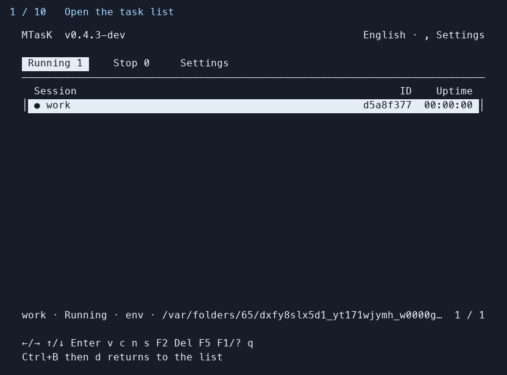

# mtask

A lightweight terminal task manager for Linux and macOS. Keep interactive programs
running after disconnecting, and return to them from a simple task list.

[简体中文](README.zh-CN.md) · [Usage](docs/usage.md) · [Compatibility](docs/compatibility.md)

mtask runs each task under an independent PTY broker. It includes its own CLI and
TUI and needs no tmux, screen, zmx, database, or Go installation at runtime.
During an attached session, application bytes go directly to your terminal.

**Status: pre-release, v0.4.3-dev.** Public releases and an APT repository are not
available yet. Screen restoration has limitations; read the compatibility notes
before relying on mtask for important work.



The demo uses a shell in temporary state. It shows the list, attach/detach,
monitoring, stop confirmation, and retained output history; it does not simulate
an AI agent or claim to demonstrate SSH reconnect.

## Build and install

Build on Linux or macOS with **Go 1.26+**, Git, and make:

```sh
git clone https://github.com/raywcm/mtask.git
cd mtask
make build
./scripts/install.sh --prefix "$HOME/.local" ./bin/mtask
"$HOME/.local/bin/mtask" --version
```

The repository is currently private; cloning requires access to `raywcm/mtask`.
From an existing local source checkout, start with `make build`.
If `~/.local/bin` is not on your PATH, use the full path above or `./bin/mtask`.
The installer replaces the executable atomically and leaves existing tasks running.

## First session

```sh
mtask new --name work -- bash
# In the task: Ctrl+B, then d, detaches without stopping it.
mtask
# Select work and press Enter to return to the same process.
```

Over SSH, run mtask **on the remote host**. After a dropped connection, SSH back
into the same host/account and run `mtask` again. Persistence across disconnects
requires the host to allow background user processes; machine reboots end them.

In the list: ↑/↓ selects, Enter attaches, `n` creates a shell, `v` monitors,
`s` asks before stopping, F2 renames, Delete asks before deleting a stopped task,
Tab switches tabs, and F1/? opens help. **Ctrl+C exits the TUI**; inside an
attached application it is passed to that application.

Stopped tasks open their output history with Enter. Esc/q returns to the list.
**Stopped records and logs are deleted after one hour by default.** Change this
before a task ends if its history must be kept:

```sh
mtask settings set history-retention off
```

## CLI and connection modes

```sh
mtask new -d --name build -- make test
mtask list --json
mtask show build
mtask logs --follow build
mtask stop build
mtask list --history --json
mtask delete build

mtask attach work                 # Exclusive control (default)
mtask attach work --read-only     # Watch without sending input
mtask attach work --shared        # Share input with other controllers
mtask attach work --takeover      # Disconnect existing controllers
```

The three explicit modes are mutually exclusive. They require brokers from
v0.3.0 or later. Older brokers keep running and retain normal exclusive attach.
A shared session uses the oldest connected controller's terminal size. All
connections require the same Unix user ID; this is not cross-account access control.

## Features and boundaries

- Independent task brokers; closing the list does not stop tasks.
- Running/stopped tabs, resource information, output history, and configurable retention.
- CLI JSON output, named tasks, rename/stop/delete, and bounded output logs.
- Chinese, English, Japanese, Spanish, and French; language packs are extensible.
- Linux/macOS, amd64/arm64 builds from a single Go codebase.

**Reattach currently restores known terminal modes and asks full-screen programs
to redraw. It does not restore a complete screen snapshot or your terminal's
scrollback.** Results depend on the application and terminal extensions used.
Monitoring changes the task's PTY to the preview size and retains that size when
leaving; an occupied task displays “Unable to monitor” without automatic takeover.
An ordinary full attach uses the full terminal size.

A crashed broker cannot be replaced while retaining its PTY. `mtask recover TASK`
only reconciles stale metadata. Reboots, OOM kills, and host login-session cleanup
can end tasks. See the [tested compatibility and limitations](docs/compatibility.md).

## Development and verification

```sh
make check                       # vet and race-enabled unit tests
make integration                 # Real processes and PTYs; Python standard library
python3 -m venv .venv
.venv/bin/pip install -r scripts/requirements-screen.txt
make acceptance PYTHON=.venv/bin/python
python3 scripts/third_party_notices.py --check
```

Acceptance tests use isolated temporary state and do not attach to user tasks.
See [stability acceptance](docs/stability.md) for scope and evidence. CI runs on pushes and pull requests; inspect the actual results in
[GitHub Actions](https://github.com/raywcm/mtask/actions). Local acceptance
evidence and hosted CI results are recorded separately.

The default state directory is `$XDG_STATE_HOME/mtask` or `~/.local/state/mtask`;
`--state-dir` and `MTASK_STATE_DIR` override it. Directories are private (0700),
metadata/logs are 0600, and Unix socket peers verify the user ID. Output logs
retain two files of approximately 8 MiB each. Arguments and output can contain
sensitive application data; raw logs reproduce terminal control sequences.

## Project documentation

- [Detailed usage (Chinese)](docs/usage.md)
- [Compatibility matrix](docs/compatibility.md)
- [Reproducible stability acceptance](docs/stability.md)
- [Build, installation, and packaging](docs/installation.md)
- [Architecture](docs/architecture.md) and [protocol](docs/protocol.md)
- [Adding a language](docs/i18n.md)
- [Development log](docs/development-log.md)

Licensed under [MIT](LICENSE). Dependencies retain their own licenses; original
texts are included in [third-party notices](THIRD_PARTY_NOTICES.md).
