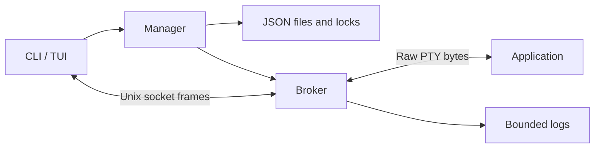

# Architecture

Each task has an independent broker, started by re-executing the same binary as
`__broker` in a new session. The broker owns the PTY, application session, output
logs and runtime state. A readiness pipe synchronizes startup. Frontend exit does
not cancel the task.

## Modules

| Module | Responsibility |
| --- | --- |
| task, store | Data, validation, atomic snapshots and file locks |
| protocol, ipc | Bounded frames, Unix sockets, UID and instance checks |
| broker, daemon | Subscriptions, control ownership, supervision and logs |
| ptyprocess | PTY, resize, wait and process-session signals |
| service | Shared CLI/TUI operations and startup |
| terminal | Raw mode, byte forwarding, detach keys and cleanup |
| tui, monitor | Task list, dialogs and preview terminal |
| config, i18n, metrics, history | Settings, languages, resource sampling and expiry |

## Lifecycle and storage

Startup becomes running after the listener and PTY are ready. The broker calls
Wait once, records exit status, drains output with a deadline, then closes clients.
Stop signals the managed session with TERM, followed by KILL after one second.
Linux enumerates processes through `/proc`; macOS uses system process queries.

`spec.json` and `runtime.json` are separate snapshots. Catalog locks serialize
create/rename/delete/recover; a broker lock spans each task's lifetime. Writes use
a temporary file, fsync, rename and directory fsync. Directories are 0700 and
files 0600. Socket peers verify UID, task ID and broker instance ID.

A dead broker leaves an unreachable record. Recovery takes its lock and updates
metadata without signalling a stored PID. A new broker cannot recover its PTY.

## Connections and terminal ownership

The TUI releases terminal ownership before attach enters raw mode. A separately
opened `/dev/tty` uses cancellable native poll; readers stop before termios is
restored. Signals are bridged into graceful TUI exits.

Application output bypasses the TUI renderer. Input recognizes F12, Ctrl+B then
d or Ctrl+D, and the legacy Ctrl+] then d. Bracketed paste bypasses shortcuts.
A bounded input buffer handles split CSI sequences; incomplete escapes flush
after 50 ms. `--no-escape` bypasses all input transformations.

Each output subscription has an approximately 2 MiB queue. A slow client is
disconnected independently. Exclusive, takeover, read-only and shared connections
use the same stream; only the oldest controller resizes the PTY. Permission
checks and complete input writes are serialized with control changes.

There are at most 32 connections per broker. Data frames are limited to 64 KiB,
control frames to 8 KiB. Logs retain two approximately 8 MiB files. Log write
failure does not stop live output.

## Screen recovery and preview

At attach boundaries, known modes are read from bounded logs and the instance's
`terminal.json`. Full-screen programs receive a temporary one-row resize and a
redraw wait of up to two seconds. No full screen snapshot or scrollback is kept.

The monitor uses a separate VT fed from retained logs. It acquires an exclusive
display connection, uses the pane size and retains that size when leaving.
Repeated identical sizes are ignored. Device replies are disabled; only rendered
cells and SGR reach the frontend. The VT is limited to 512×256 cells and about
4 MiB of parser buffering. Only the selected preview is active.

A per-state-directory `__history` process removes expired stopped records once
the broker lock is free. Retention defaults to one hour; zero disables it.
The worker is independent of frontend and task lifetimes.

See [protocol](protocol.md), [testing](stability.md) and
[compatibility](compatibility.md).
