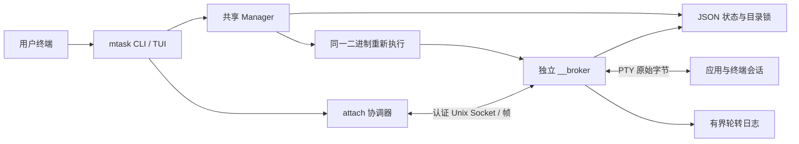
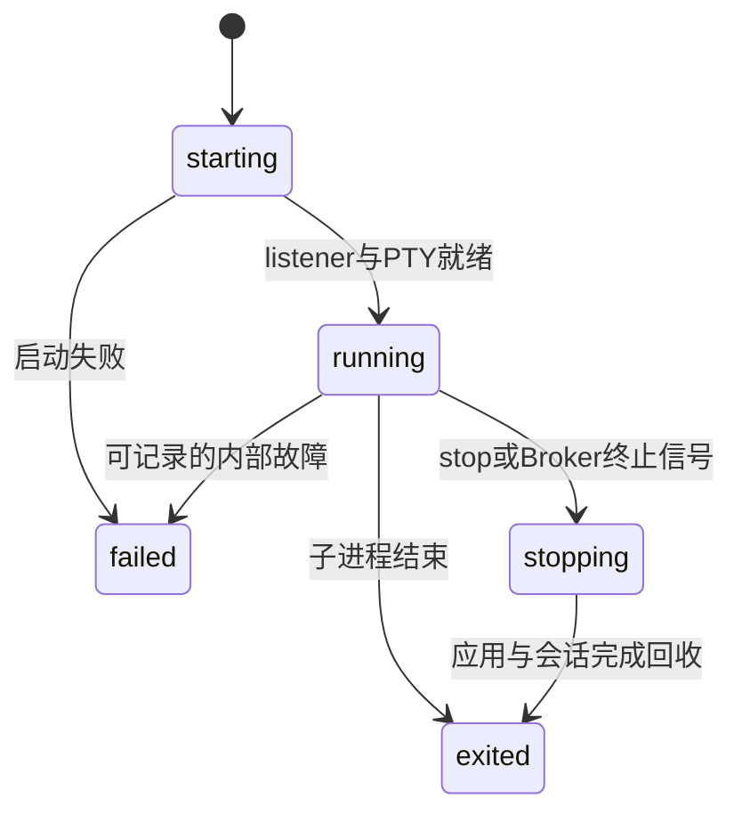

# mtask 架构

更新：2026-10-28。初始设计保存在 [A0 存档](archive/architecture-a0.md)。

## 进程与数据通道



每个任务对应一个独立 Broker。启动器通过新的 session 重新执行同一二进制的隐藏 `__broker` 命令，stdio 与前端分离，通过继承的专用 pipe 等待 readiness。启动等待由 readiness pipe 同步。启用历史保留策略时，每个状态目录另有一个只清理终态元数据和日志的轻量维护进程。前端 context 的取消只影响启动等待或当前连接，任务生命周期由 Broker 管理。

Broker 持有自己的排他锁、listener、PTY、应用会话、状态和日志。PTY 由 creack/pty 创建，应用拥有 controlling terminal。只有 Broker 调用一次 Wait 并记录退出码。正常非零退出是应用结果，不是 Broker 内部异常。

## 模块边界

| 模块 | 实现职责 |
| --- | --- |
| task | spec/runtime/record、ID、argv、尺寸、状态模型 |
| store | 目录/文件权限、UID 检查、JSON 原子替换、catalog 和 Broker flock |
| protocol | 版本化帧、长度上限、短读短写、完整帧写入序列化 |
| ipc | Socket 路径、peer credentials、身份握手、Probe/Stop 客户端 |
| broker | 独占/接管/只读/共享租约、有界多订阅输出 Hub、Process/Spawner 契约 |
| ptyprocess | PTY 创建、pollable FD、resize、wait、会话枚举和信号 |
| daemon | supervisor、listener、连接资源限制、状态持久化、日志轮转 |
| service | CLI/TUI 共用 Manager 和业务操作；readiness 启动器 |
| terminal | 可取消的双向转发、Raw Mode、SIGWINCH、detach 与清理 |
| cli/tui | 用户界面；不直接操作应用 PID |

依赖不从 Broker 指向界面。原始终端输出不经过 Bubble Tea、不作为字符串或 JSON 编码，只加帧头后转发。日志显示可清理控制序列；这与 live 通道独立。

## 生命周期



- readiness 在 running 状态落盘、输出循环和 listener 启动后发送。极快结束的应用可能在创建返回前已进入 exited。
- 启动失败保留 spec 和可用的 failed 状态；启动等待超时被视为结果不确定，错误包含任务 ID，供后续 show 协调。
- attach/detach 是连接状态，不是任务运行状态。断开只释放连接控制权。
- Stop 通过认证 Socket 请求，TERM 发送到同一终端会话的进程，一秒后对仍存在的会话成员发送 KILL。macOS 使用 sysctl 枚举，Linux 使用 `/proc` 和 getsid，不依赖外部 ps。
- Wait 与 PTY EOF 独立。主进程结束后清理仍持有 slave 的会话成员，最多等待 250 ms 排空尾部，再关闭 PTY。
- 退出快照先落盘，再结束输出订阅、发送 Exit、关闭连接和 listener。连接排空最多额外 300 ms；stop 等待 Broker 锁释放后返回。
- Broker 被 KILL 时无法执行最后写入。服务层将陈旧 running 快照显示为 unreachable；recover 在拿到排他锁后标为 failed，不操作过期 PID。

刻意 daemonize、脱离原会话或忽略终端挂断的进程在 Broker 意外崩溃后可能残留。新 Broker 也不能接管已经丢失的 PTY master。

## 多终端连接、背压与资源上限

默认独占连接遇到已有控制端时返回 busy；额外支持接管、只读和共享。Hub 管理多个独立有界订阅和一个尺寸主控；接管撤销全部控制订阅但保留只读订阅，离线时按加入顺序提升下一个共享控制端。control 查询允许并发，每 Broker 总连接数上限 32，握手有 2 秒截止时间，空闲 control 读取最多 30 秒。

输出 Hub 每订阅最多 64 × 32 KiB，约 2 MiB。PTY 不依赖客户端持续读取；无客户端时通常只写日志。新建前台任务额外保留最多 2 MiB 的启动字节并在首次连接时交付，之后重连不回放；超过上限的启动缓冲释放，仍可查看有界日志。队列满则取消慢客户端并关闭其 Socket，任务继续运行。订阅对象是租约，旧连接的清理不会误断开新连接。

输入/输出帧载荷上限 64 KiB，控制帧 8 KiB；Socket 和 PTY 写入均有截止时间。客户端所有读取循环在 detach 时取消并等待结束，之后才能重启列表。

输出日志两个文件各最多约 8 MiB，持续高输出不会无限占用磁盘。存储日志失败时诊断写入 broker.log，关闭日志写入但继续应用转发。日志按私有文件保存，可能包含应用输出中的敏感数据。

## 终端所有权

TUI 结束并恢复它自己的终端设置后，attach 才获取 Raw Mode。单独打开 `/dev/tty`，使用可取消的 native poll 进行读取和写入；macOS `/dev/tty` 不适合直接依赖 Go kqueue 的文件读取行为。取消轮询后等待 goroutine 结束，再恢复 termios，最后清理常见鼠标、粘贴、焦点、键盘增强和备用屏幕模式。

Ctrl+C 按字节发给 PTY，由应用的 termios 决定是否产生 SIGINT。默认输入变换为 Ctrl+B d detach，并兼容 Ctrl+] d；两种前缀都支持双按转义，`--no-escape` 禁用全部前缀。这条规则跨任意读取边界保持状态。关闭 Socket 也释放控制端。

SIGWINCH 同步尺寸。连接前及退出连接时，客户端仅在边界扫描有容量上限的输出日志，并维护同一实例的 terminal.json 模式检查点；正常 live 输出不进入解析器。恢复仅合成白名单内的备用屏幕、鼠标、焦点、粘贴、方向键、数字键盘、插入和光标样式控制，不回放文字、OSC/DCS、查询或剪贴板命令。禁用模式先应用，再启用活动模式，避免鼠标协议别名的 reset 抵消恢复。

重新进入已知全屏应用时，先进入独立备用屏幕并清除该屏幕，再通过协议 v1 resize 短暂减少一行、等待实际清屏信号（最多 2 秒）、恢复真实尺寸，触发 ncurses 完整绘制。普通 Shell 不被强制放进备用屏幕。该重绘过程使用原有 v1 协议。没有完整 VT 快照时，恢复依赖日志中保留的模式和应用重绘；日志轮转或不支持的键盘协议可能使恢复不完整。

## 存储与并发

```text
state/                           0700
  catalog.lock                   0600
  tasks/<random-id>/             0700
    spec.json                    0600，服务层写
    runtime.json                 0600，Broker 单写
    broker.lock                  0600，排他运行锁
    terminal.json                0600，客户端连接边界模式检查点
    output.log / output.log.1    0600，有界原始输出
    broker.log                   0600，内部诊断
```

spec 包含名称、argv、cwd、创建时间和初始尺寸，不保存完整环境。runtime 包含随机实例 ID、PID、状态、更新时间、退出码和信号。PID 仅用于诊断，控制通过实例握手完成。

创建/重命名/删除/recover 由 catalog flock 串行化；创建事务含有最长 5 秒 readiness 等待，防止同名任务在启动中被删除或再次创建。Broker 的独立 flock 覆盖其整个生命周期。终止后的 ID 不重用，重启需新建任务。

写入采用同目录临时文件 → 文件 fsync → rename → 目录 fsync。rename 后同步失败属于不确定持久化结果，应重新读取协调，不盲目覆盖或回滚。spec/runtime 独立快照，避免重命名覆盖运行状态。

创建中断可能留下无 spec 的保留目录，列表忽略；不主动扫描删除未知目录。读操作不创建不存在的任务目录。元数据损坏时返回读取错误。

## 本地安全

- 状态和运行时目录检查 owner、权限和类型，拒绝最终路径 symlink；元数据拒绝非普通文件或公共权限。
- 锁采用 O_NOFOLLOW + Fstat，拒绝错误 owner 和类型；任务路径只使用校验后的随机 ID。
- Socket 使用可信的 XDG_RUNTIME_DIR，或短 `/tmp/mtask-uid/state-hash/` 私有路径，路径上限 100 字节，Socket 0600。
- Linux SO_PEERCRED / macOS LOCAL_PEERCRED 双向核验 UID，再核验协议版本、任务 ID 和实例 ID。
- 仅持有 Broker 排他锁后可清理自己的陈旧 Socket；不盲目删除冲突路径。
- argv 不经隐式 shell；名称拒绝控制字符，名称和参数校验 UTF-8，参数拒绝 NUL，界面输出转义元数据。
- recover 不向文件中的旧 PID 发信号。相同 UID 的恶意进程和受入侵的用户目录不作为隔离边界。

## 安装和升级

GoReleaser 定义四目标 CGO=0 构建、归档、校验清单和 Linux Deb/RPM；nFPM 单独配置支持独立打包。本地 APT 索引脚本只生成文件。Actions 运行检查并上传附件，公开发布关闭。

安装器用同目录临时文件加原子 rename，旧 Broker 保持已加载代码。协议 v1 与磁盘 schema v1 独立于二进制版本。卸载不主动终止后台任务或删除用户数据，升级兼容性由集成测试验证。

## 测试

`scripts/integration.py` 对实际二进制执行任务管理、真实 PTY attach/断开/强杀/重连、字节透明、Unicode、resize、Ctrl+C、单客户端、会话子进程、并发、异常 Broker、日志轮转和原子升级测试。单元测试覆盖帧/Hub/存储/终端原语，race 检查配合真实 Broker 集成测试。

平台和应用测试范围见[兼容性表](compatibility.md)，脚本用法见[测试说明](stability.md)。

## 界面、配置和资源采样

TUI 的 Running/Stop 标签、设置页和 CLI 共用 Manager。界面状态保存当前标签和两个标签各自的选择位置；进入任务时退出 Bubble Tea，恢复原样字节连接，断开后重建列表并恢复完整任务 ID 的选择。显示短 ID 不改变协议、任务身份或 JSON 输出。

`internal/config` 定义有版本的设置及默认值，`internal/store/settings.go` 在目录锁下以 0600 权限原子保存；`internal/i18n` 从嵌入的 JSON 语言包元信息自动注册语言、名称、排序与地区别名，提供英语回退；目前附带五种完整语言。设置不修改运行中 Broker 的参数。

`internal/metrics` 在列表端采样任务子进程树，校验根进程的父 PID 与 Broker 一致，以启动身份防止跨样本 PID 复用。Linux 从当前 UID 的 `/proc` stat 读取累计 CPU ticks 和 RSS；macOS 使用固定参数及 C locale 的 `/bin/ps`，700 毫秒截止时间。首次采样不计算 CPU；间隔超过 15 秒时重置基线。RSS 是进程求和，可能重复计算共享页。该路径与 PTY 输出转发独立。

Runtime 的 started_at / finished_at 为可选字段，旧版文件及 v1 Broker 仍能读取。资源数据仅由列表观察生成，不写入持久状态。

重连重绘使用连续协议帧读取器；对全屏应用临时缩小尺寸，等待应用的清屏信号或有界超时，再恢复真实尺寸。等待阶段的原始帧有数量/容量上限并按原顺序输出，避免 socket deadline 在半帧中打断读取。普通连接继续不解析应用内容。

## 语言包与历史清理

语言定义完全由 `internal/i18n/locales/*.json` 驱动。语言代码、原生名称、顺序、别名和文案在同一文件中；配置验证、TUI 切换和自动识别读取统一注册表，不再维护多份语言枚举。新增语言只需增加完整语言包并重新构建，详见[语言包说明](i18n.md)。

历史维护在隐藏的 `__history` 进程中执行，作用域为单个状态目录；history.lock 保证只有一个有效实例。默认保留 3600 秒，0 禁用。每轮在 catalog.lock 内重新读取策略并扫描，取得候选任务的 BrokerLock 后才清除 Socket、元数据和日志，不按旧 PID 发信号。已结束记录优先使用 FinishedAt，旧记录用 UpdatedAt，未启动记录用 CreatedAt。

维护进程独立于前端与 PTY Broker，关闭前端后定时器继续运行。空状态/禁用时退出前，在 catalog.lock 内复核并先释放 history.lock，避免与新建任务或重新启用策略产生退出竞态。它只校验所需的保留时长字段，避免新版本增加语言或偏好导致旧维护进程无法执行策略；状态目录消失时退出，不重建目录。设置修改先保存后启动维护，避免用户第一次关闭自动清理时先按旧策略删除记录。

## 连接同步与兼容

Hello 的 attach_mode 和 capabilities、Welcome 的 attach_mode/size_owner/size/capabilities 是 v1 可选扩展。Notice(12) 只发给声明 attach-modes-v1 能力的新客户端，用于角色变更与主控重绘请求。非默认方式先通过只读 control 握手检查 Broker 能力，再提交 attach；旧 Broker 忽略未知 JSON 字段，客户端须先确认能力，再请求 readonly。

Hub 的成员表、订阅序号及主控归属在同一锁下修改，陈旧 Detach 只操作原订阅。Publish 复制每个输出块并扇出到各有界队列，单个慢客户端独立断开；关闭 Done 前公布 taken_over/slow_client 原因。server.attachMu 将接管/断开与权限检查、整帧 PTY Write 和 Resize 串行化，避免已撤销连接在接管完成后继续写入。该锁不覆盖输出转发，Hub 锁也不覆盖 PTY I/O。

只有尺寸主控会应用 Resize；共享的非主控 Resize 被忽略，只读的 Input/Resize/Stop 在 Broker 端拒绝。只读前端仍读取本地按键以识别 detach，但丢弃其他输入及终端自动应答。所有有输入权的连接仍保持原样字节传输，不解析或仲裁多人输入的业务含义。

新旁观/共享连接触发主控 Notice(refresh)。支持的新主控在连接边界检查全屏模式并执行既有有界重绘握手，输出仍广播给全部连接。旧主控或没有主控时只请求应用重绘；旧 OSC、终端查询和 Shell 滚动历史不回放。只读端和非主控端不参与尺寸竞争。

## 监控、弹窗与命名

internal/monitor 只在监控页为选中任务建立显示租约。先用 control Welcome 查询新 Broker 的当前尺寸，旧 Broker 回退 Spec.Size；随后直接以面板尺寸用普通 exclusive attach 建立连接，不自动接管已有控制端。Socket 持续排空并接收结束/错误，但不向 PTY 发送 Input。右侧面板尺寸通过已有 Resize 消息同步，取消时保留监控尺寸并发送 Detach，等待 EOF 确认 Broker 已释放租约，再允许完整 attach，避免监控转进入时的 busy 竞争。相同尺寸在前端发送和新 Broker 应用时都去重，不在重新进入时回到旧 Spec.Size。

显示从私有 output.log.1/output.log 的保留历史和增量读入独立 VT（固定依赖 github.com/charmbracelet/x/vt v0.1.0）。这样既能建立进入前的画面，也避免日志与订阅输出重叠回放。输出文件 O_NOFOLLOW、只读、regular/UID/权限检查；读取按块检查取消，日志轮转后换代。输出文件持续两秒不可用时，返回错误并释放连接。虚拟屏幕上限 512×256，关闭滚动历史，单个解析缓冲约 4 MiB，始终只有所选预览存活；画面约每 100 ms 更新。设备查询的输出管道关闭，历史 OSC/剪贴板/链接/设备应答不进入主终端；只从屏幕单元生成 SGR 与可打印字符。该解析器不进入 PTY Broker 或完整 attach 路径。

TUI 通过带代号的异步打开和轮询消息接收屏幕快照。选择、页面、退出和上下文取消会关闭旧预览，陈旧消息不会覆盖当前会话；普通 attach 后恢复同一监控状态。确认弹窗由完整不透明行叠在变暗背景上，支持 CJK 宽度和小窗口。弹窗几何切换触发一次 ClearScreen，避开实时背景下硬件区域滚动的缓存残影；普通监控继续增量刷新。确认缺省取消，候选名称与任务完整 ID 绑定。

`service.NameConflictError` 携带 Name/Suggestion。预检查只提出建议，最终 Create/Rename 仍在 catalog.lock 下查重，不静默更换名字。若确认之后发生竞争，TUI 再次展示新建议。编号截取前缀时以 UTF-8 rune 为边界，确保总长度不超过 128 字节。CLI 返回重名错误及建议。

## TUI 退出

进程信号由 main 的 NotifyContext 统一处理；TUI 将父 context 取消转换为模型退出消息，Bubble Tea 禁用自己的重复信号处理器并使用保留 context 值但不继承取消的运行 context。这样信号与按键都经过正常收尾：最终 View 为空且仍处于备用屏幕，渲染完成后恢复原命令行；输入读取被取消并等待结束后再关闭，避免 killed 路径中的读取/Close 竞态。Run 返回前回收状态加载、历史读取和监控连接；后端错误继续返回调用方。
