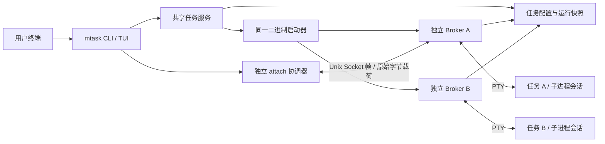
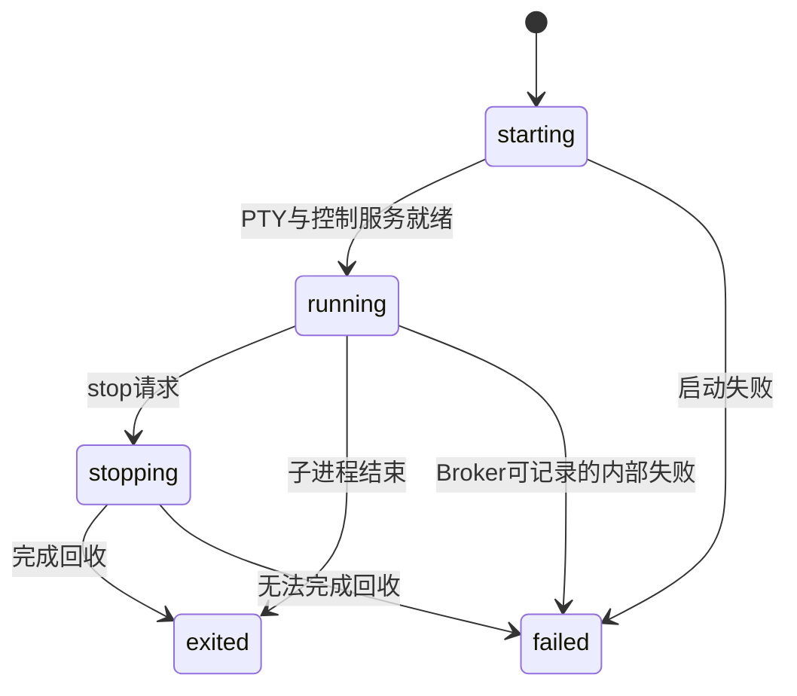

# mtask 基础架构设计

日期：2026-10-27（Asia/Shanghai）。阶段：A0 基础架构。本文区分已落地组件和后续实现契约；不把设计承诺当作功能验收。

## 1. 范围与目标

本阶段确定大的框架、关键接口和关键代码，建立能编译、能测试的工程。完成后停止，不进入完整 Broker/CLI 产品实现，不发布软件。

核心约束：

1. 每个任务拥有独立的后台 Broker，不依赖 tmux、screen、zmx 或常驻全局服务。
2. 任务生命周期由 Broker 管理，与 CLI/TUI 和连接生命周期分离。
3. 连接期间，应用输出不进入 Bubble Tea，不解析或重绘 ANSI；按顺序转发原始字节。
4. TUI 和 CLI 通过同一应用服务执行操作，存储与进程操作不散落在界面层。
5. Go 单二进制；当前目标为 Linux/macOS，不承诺 Windows。

“透明”指数据通道与终端所有权的原则，不能等价于所有终端能力已无损兼容。额外 PTY、环境变量、尺寸、终端查询响应、断开后的模式恢复都需要实测。重连后完整屏幕和宿主终端滚动历史无法只靠字节转发自动重建。

## 2. 进程关系

以下是最终接线目标；本阶段尚无 `__broker` 命令和 Socket 服务。



- Broker 通过同一个可执行文件的隐藏子命令启动，使用新的 session，标准输入输出与前端分离；诊断进入受限文件，应用输出只来自 PTY。
- 每个任务的子进程通过 `pty.StartWithSize` 获得自己的 session 和 controlling terminal。Broker 不是该 PTY 的交互应用。
- 启动者通过专用 readiness pipe 等待结果；禁止用固定 sleep 判断“已启动”。
- 断开 attach 只关闭客户端连接、释放控制权，不关闭 PTY、不取消任务。
- 系统关机、OOM、管理员终止、SSH 服务或 systemd 主动清理整个登录会话不在单纯 `setsid` 的保活保证内；这些环境需后续单独验收和部署说明。

## 3. 模块职责与依赖

| 模块 | 当前实现 | 后续扩展 |
| --- | --- | --- |
| `task` | 纯数据模型、输入校验、状态迁移规则 | 更严格的状态不变量、结构化错误 |
| `protocol` | 有界帧编解码及消息结构 | 消息语义验证与连接状态机 |
| `broker` | `Process`/`Spawner`/`Launcher`/`Control` 契约、Hub、输出 Pump | supervisor、listener、单写者锁、退出/停止协调 |
| `ptyprocess` | PTY 创建、I/O、resize、Wait | 进程会话清理和各平台信号适配 |
| `store` | 私有文件、配置与运行快照分离、原子替换 | catalog 锁、损坏文件隔离与协调 |
| `service` | 任务列表共享入口 | create、rename、stop、delete、probe |
| `terminal` | Raw Mode 恢复、detach 输入状态机 | 可取消 I/O、SIGWINCH、退出时模式恢复 |
| `cli` / `tui` | 列表及选取骨架 | 管理操作与终端交接 |
| `config` | 状态目录解析 | 运行时 Socket 路径与配置版本 |

依赖方向：界面 → service → 存储/启动器/控制接口；PTY adapter → broker 接口；共同依赖 task。Broker 不导入 UI，数据通道不调用 UI renderer。接口仅放在已有边界，不建立无实现的通用插件系统。

## 4. 已定的关键决策

### 4.1 每任务一个 Broker

单个 Broker 故障只影响一个任务；升级前端无需重启所有任务。代价是每任务一个 Go 进程，需要后续测量实际内存占用。当前不增加全局 daemon 或任务调度器。

Broker 一旦死亡，PTY master 无法由新的 Broker 原样接管；子进程可能收到挂断，也可能仍残留。状态应标记为不可达并进入协调，不能宣称“自动无损恢复”。

### 4.2 控制端唯一，读 PTY 不依赖连接

首版同一任务只允许一个可写控制端；第二个 attach 返回 `busy`。首版不提供强制抢占、共享输入、多人协作或只读观察者，避免输入竞争与尺寸争用。

已实现的 Hub 为活动客户端提供 64 × 32 KiB 的队列，最多约 2 MiB 载荷。没有客户端时继续读取并丢弃输出；队列满时使当前订阅失效，不阻塞任务，也不在丢掉一部分字节后继续同一个屏幕流。Hub 的订阅对象是租约，旧连接的延迟清理不会断开新连接。

后续连接处理器必须在订阅 `Done` 后主动关闭 Socket，并为 Socket 写入设置超时。Hub 只保证自身的内存和锁行为；它不能代替连接级取消。控制消息使用独立生命周期通道，不能排在饱和的普通输出队列后无限等待。

### 4.3 双向通道分帧，载荷不解析

单条 Unix Socket 复用原始输入、原始输出、resize 和生命周期消息。头部有版本、类型、长度；终端内容放在二进制载荷里，避免把输出转成 JSON 文本或 Base64。

编码器一次锁定完整帧，防止输出/退出/resize 帧并发交错；解码器分配内存前验证长度。详见 [协议草案](protocol-a0.md)。

### 4.4 TUI 与 attach 轮流拥有终端

计划中的交接顺序：

1. TUI 返回选中 ID，`tea.Program.Run()` 完全结束并恢复其终端设置。
2. attach 连接并验证 Broker，调整 PTY 尺寸，取得唯一控制权。
3. attach 打开自己的可关闭终端句柄，保存 termios，进入 Raw Mode；输入输出通过专用循环转发。
4. detach/EOF/异常/TERM/HUP 时取消循环、关闭连接，等待所有读写 goroutine 退出，再恢复 termios 和已管理的终端模式。
5. 只有清理完成后才重新启动列表 TUI。不能留下一个后台 goroutine 继续读取标准输入。

当前实现 `WithRaw` 的 termios 恢复，不包含鼠标、备用屏幕、焦点、bracketed paste 或增强键盘协议状态的恢复。后续需要单独的 attach 清理策略和兼容性测试，避免误称 `term.Restore` 能恢复全部终端画面。

默认计划使用 `Ctrl+]` 后按 `d` 返回列表；双按 `Ctrl+]` 发送一个字面前缀；未知组合完整转发。前缀解码器已实现且跨读边界保持状态，可禁用以获得输入完全透传。该前缀会改变原本含有该字节序列的输入（包括粘贴），因此配置必须允许禁用或调整。Ctrl+C 的字节交给 PTY，由子应用当前 termios 决定其含义。

### 4.5 配置和运行快照分开

```text
state/                         0700
  tasks/                       0700
    <32位随机ID>/              0700
      spec.json                0600，服务层写：ID、名称、argv、cwd、创建时间
      runtime.json             0600，Broker 单写：实例ID、状态、PID、退出码
      output.log               后续：可选、有容量上限的原始输出日志
      broker.log               后续：内部诊断，不能混入应用输出
```

- 不保存完整环境变量，避免把令牌等秘密复制到元数据；启动时显式传入环境，Broker 将其传给应用。命令参数仍可能含秘密，因此元数据和未来日志都保持私有权限。
- 原子写顺序为同目录临时文件 → 文件 fsync → rename → 父目录 fsync。rename 已成功而目录同步失败时，调用方需重新读取以协调结果。
- `spec.json` 与 `runtime.json` 是两个独立快照，当前不提供跨文件事务。
- 初始 Create 先保留 ID 目录，再写 spec；中途崩溃可能留下无 spec 的目录，List 忽略它们。后续恢复工具负责清理，不能在扫描时随意删除。
- 本阶段只保留基础权限与路径校验；不是抵御同 UID 恶意进程的安全边界，也没有对所有祖先目录做 race-free 验证。
- 后续 catalog 锁保护名称唯一性、创建、重命名、删除；Broker 专属锁保护同一任务仅一个运行状态写者。持锁期间不等待网络或子进程。
- 运行状态文件是诊断快照；“在线/不可达/不兼容”来自带超时的实际握手。禁止仅凭 PID 存在认定任务仍活着，禁止从过期 PID 文件直接发信号。

## 5. 生命周期与并发契约

持久状态迁移：



`attached`/`detached` 是连接状态，不是任务生命周期。`unreachable` 是服务层的观测结果，不能让前端覆盖仍可能存活的 Broker 的 runtime。强制终止未必留下最后一次写入，应如实展示上一次快照及观测时间。

未来 supervisor 需要拥有以下操作及顺序：

- 加载并验证 spec、取得 Broker 排他锁、生成新的实例 ID。
- 绑定私有 Socket 并启用认证；初始状态先记录为 starting，未就绪连接返回明确错误。
- 创建 PTY 和命令；创建一次持续读循环和一次 `Wait`。非零应用退出码是任务结果，不自动等于 Broker 内部失败。
- 写入 running 快照后才通过 readiness pipe 报告启动成功；若应用极快结束，启动者收到准确的已结束结果也合法。
- PTY EOF 和 `Wait` 是两个独立事件。进程退出后尽量排空尾部输出；如果后代仍持有 slave，使用有界排空时间，不能无限等 EOF。
- 先落盘退出状态，再发送 Exit，关闭 listener 和所有连接，最后清理自己的 Socket；元数据保留为历史。
- 启动超时是结果不确定，按 ID 协调，不能盲目重试制造第二个任务。启动 Broker 之前失败时可能只有 spec、没有 runtime，不能伪造已成功运行。

停止策略需要单独实现：向受管理的前台进程组和任务会话发温和终止，经过宽限期再强制终止并回收。交互 shell 的 job control 会产生多个进程组，不能只杀 shell PID 或一个负 PID 就声称清理完整；Linux/macOS 的会话内后代枚举与身份检查列为后续验收项。主动 daemonize 逃离任务会话的程序不承诺可完整回收。

## 6. 本地安全和资源边界

尚未创建 Socket；以下是 listener 上线前的实现门槛：

- 优先用可信的 `$XDG_RUNTIME_DIR/mtask/<state-hash>/`；无此目录时使用短的 `/tmp/mtask-<uid>/<state-hash>/`。分层目录以 `0700` 创建并检查 UID、类型、权限；发现 symlink 或不可信已有目录立即失败。
- Socket 以 `0600` 提供访问；创建时设置合适 umask。控制路径使用随机 ID，不使用用户提供的任务名。检查编码后 Socket 路径长度，不静默截断。
- Linux 使用 Unix peer credentials，macOS 使用对应的 peer UID 查询，核验与当前 UID 一致；再验证协议版本、task ID 和 instance ID。
- 只有确认旧 Broker 不可达并持有对应锁，才可清理遗留 Socket；不能遇到 bind 冲突就 unlink。
- 帧与控制消息长度有上限；握手与写操作有超时；未认证连接数及总连接数有上限。
- 用户命令按 argv 调用 `exec.Command`。只有用户显式指定 shell 及 `-c` 时才运行 shell 语法；未来 CLI 在 `--` 后原样保留参数。

当前程序不会启动网络 listener，没有远程 API，也不自动发送数据到外部服务。

## 7. 重连、日志与终端兼容性

第一步重连只保证原任务仍存在及后续输出可连接，不回放历史 ANSI。已实现的 Hub 在断开时丢弃输出，尚无日志；再次连接时程序可能暂时没有新画面，这是明确的阶段限制。

后续分阶段：

1. 实现尺寸同步，条件性发送 SIGWINCH，让支持的全屏应用主动重绘。不能假设所有应用都会重绘。
2. 增加有界日志供显式查看。日志是原始输出，不等价于屏幕模型；默认不把历史控制序列自动注入当前终端。
3. 如需要完整画面恢复，引入可选的旁路终端状态跟踪。正常输出仍直接转发，快照只在重连时发送；这需要单独设计 VT 覆盖面、终端查询和备用屏幕语义，再进行性能与兼容性验收。

兼容性矩阵至少覆盖 Bash、Vim、Codex、OpenCode；原生终端与 SSH；滚动、鼠标、复制粘贴、中英文、颜色、Ctrl+C、Raw Mode、SIGWINCH、备用屏幕。当前基础测试不能替代这张矩阵。

## 8. 后续实现顺序（本次不继续）

| 阶段 | 工作 | 验收门槛 |
| --- | --- | --- |
| A0，本次 | 架构、核心原语、界面骨架、开发日志 | 编译与基础测试通过，边界明确 |
| A1 | detached launcher、Broker supervisor、认证 Socket、控制协议 | 前端退出后任务存活；真实 attach/disconnect；可靠退出码与清理 |
| A2 | 完整 CLI、目录锁、命名与历史、日志 | 创建/停止/删除/重命名语义明确；JSON 稳定；并发一致性 |
| A3 | TUI 管理操作与 attach 往返 | TUI 与 CLI 一致；无遗留输入 reader；快捷键不破坏子应用 |
| A4 | 重连恢复、兼容性与稳定性 | 原开发计划第 3–10 类场景实测，记录已知差异 |
| A5 | GoReleaser / nFPM / Actions、Deb/RPM 与软件源 | 原子升级保留旧 Broker；安装/卸载与签名仓库实测 |

发布矩阵先定为 Linux/macOS × amd64/arm64，`CGO_ENABLED=0` 单文件构建。交叉编译只证明能生成目标文件，不证明平台运行正确。`apt install mtask` 还需要确定软件源托管地址、包名归属和签名密钥，不能单靠一个 `.deb` 宣称完成。未添加假域名、占位密钥或可误触发的发布工作流。

升级使用新文件原子替换路径，不能覆盖正在运行的可执行文件内容或主动重启 Broker。协议版本、磁盘 schema 和二进制版本独立；新前端需要兼容旧 Broker，协议不兼容时明确报错。跨版本升级和卸载时仍有任务运行的策略列为 A5 验收。

## 9. 技术参考

依赖版本以 `go.mod` / `go.sum` 为准，API 已按以下一手资料及本地依赖源码核对：

- [Bubble Tea v2 文档](https://pkg.go.dev/charm.land/bubbletea/v2)：列表 UI 使用 `tea.View`，不接管子应用输出。
- [Bubbles v2](https://github.com/charmbracelet/bubbles)：列表骨架使用 help/key 组件。
- [creack/pty](https://github.com/creack/pty)：PTY、初始窗口大小与子会话的适配基础。
- [golang.org/x/term](https://pkg.go.dev/golang.org/x/term)：终端 Raw Mode 与 termios 恢复。
- [Cobra](https://github.com/spf13/cobra)：CLI 命令结构。

这些库解决局部能力；后台生命周期、安全握手与重连行为仍由 mtask 自身负责。
